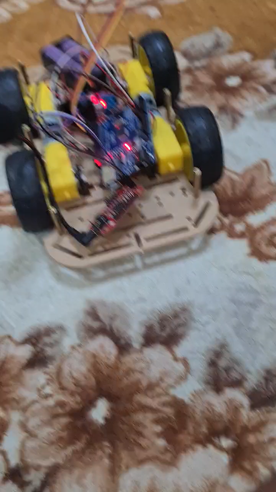
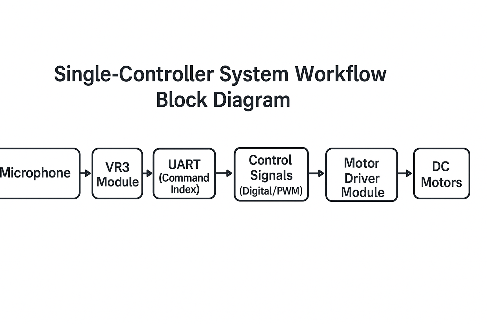
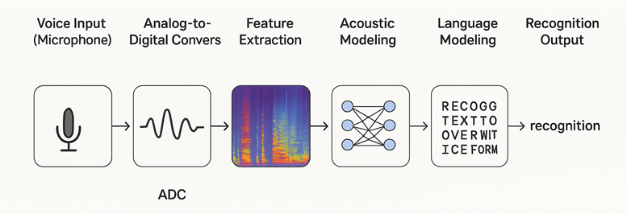
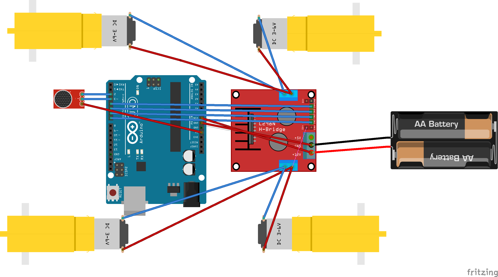
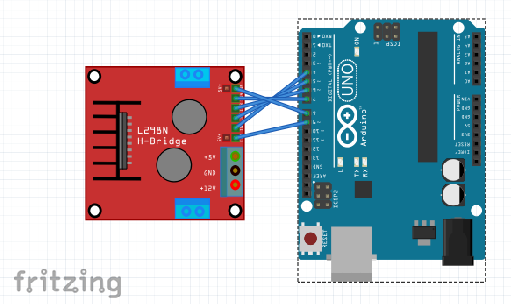
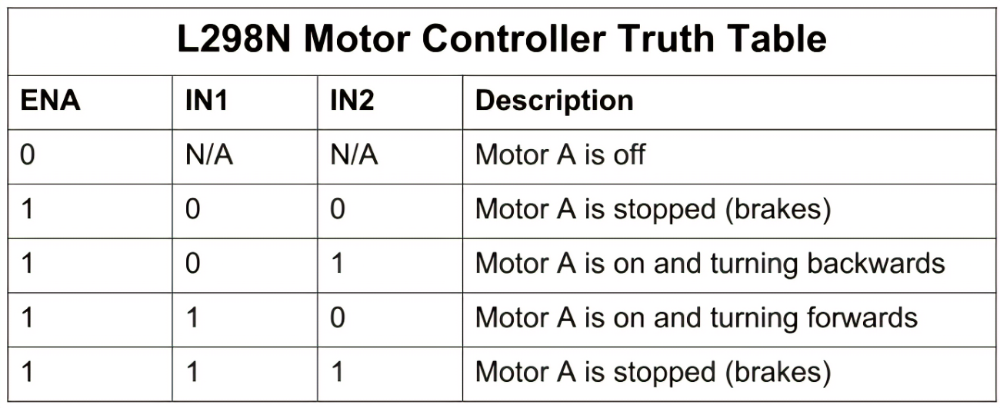

# Voice-Controlled Car (Arduino + Elechouse VR3)

> Communication Theory (EE 3622) design project · team project

A four-wheel car that you **drive with your voice**. You say "go", "back", "left", "right" or "stop", and an Elechouse VR3 speech-recognition module tells the Arduino Uno which command it heard. The Arduino then drives the motors through an L298N H-bridge.

## Results (from the project report)
Each command was spoken 50 times with moderate background noise.

| Command | Accuracy |
|---|---|
| Go | 88 % |
| Back | 90 % |
| Left | 84 % |
| Right | 86 % |
| Stop | 94 % |
| **Average** | **88.4 %** |

- **Latency:** about **650 ms** (± 48 ms) from speaking a command to the motors starting
- **Power:** the 5 V rail held between 4.95 and 5.02 V under motor load, and the 7 V pack stayed between 6.8 and 7.0 V

## How it works

1. **Speech recognition.** The VR3 module is trained on the user's voice (speaker-dependent). It matches each utterance against the stored templates and sends the command index over UART.
2. **Decision.** The Arduino maps each index to a movement.
3. **Actuation.** Arduino pins drive the L298N inputs IN1-IN4 for direction and ENA/ENB with PWM for speed.

## Hardware
| Component | Qty | Cost (SAR) |
|---|---|---|
| Arduino Uno | 1 | 30 |
| Elechouse Voice Recognition Module V3 + mic | 1 | 45 |
| L298N motor driver | 1 | 12 |
| DC motors with wheels | 4 | 20 |
| Car chassis | 1 | 30 |
| 18650 battery pack (7 V) + holder | 1 | 17 |
| Jumper wires and breadboard | - | ~10 |

| Wiring (Fritzing) | Arduino → L298N pins | L298N truth table |
|---|---|---|
|  |  |  |

The editable wiring file is [`hardware/voice_control_car.fzz`](hardware/voice_control_car.fzz) (Fritzing).

## Limitations and future work
The VR3 module is speaker-dependent, so it has to be retrained for each user. Next steps are speaker-independent recognition, better noise robustness, a larger vocabulary and obstacle sensors.
